# Nicolly Xavier

**Software Developer · Frontend & AI Enthusiast**

Transformo ideias e problemas reais em experiências digitais, combinando desenvolvimento de software, design de interfaces e tecnologia.

Sou formada em Engenharia da Computação e atualmente curso Análise e Desenvolvimento de Sistemas. Meu foco está no desenvolvimento frontend, mas gosto de explorar diferentes áreas da engenharia de software, especialmente integração de sistemas e inteligência artificial.

[LinkedIn](www.linkedin.com/in/nicolly-xavier-lima) · [Projetos](https://github.com/NicollyXavier?tab=repositories)

 

---

### 01 / O que faço

- **Frontend:** desenvolvimento de interfaces com React, Next.js e TypeScript.
- **UI/UX:** prototipação, refatoração visual e construção de experiências intuitivas.
- **Software Engineering:** integração de APIs, organização de aplicações e boas práticas.
- **AI & Innovation:** exploração de inteligência artificial aplicada a problemas reais.

### 02 / Tech stack

**Frontend**

**Backend & Data**

**Tools & Design**

### 03 / Beyond the code

Acredito que tecnologia também é sobre entender pessoas e contextos.

Algumas experiências que marcaram minha trajetória:

- Desenvolvimento de soluções para desafios de inovação e impacto social.
- Projeto de realidade virtual para treinamento de bombeiros, premiado na Mostra de Projetos da UNINASSAU.
- Pesquisa e desenvolvimento de protótipo de inteligência artificial aplicado à triagem de sinais de alerta para TEA.

### 04 / GitHub activity

  <picture>
    <source
      media="(prefers-color-scheme: dark)"
      srcset="./assets/overview.dark.svg"
    />
    
  </picture>

   

  <picture>
    <source
      media="(prefers-color-scheme: dark)"
      srcset="./assets/languages.dark.svg"
    />
    
  </picture>

  Um pouco da minha jornada de desenvolvimento por aqui.

---

**Construindo, experimentando e aprendendo. Um projeto de cada vez.**

Recife, Brasil · © Nicolly Xavier

